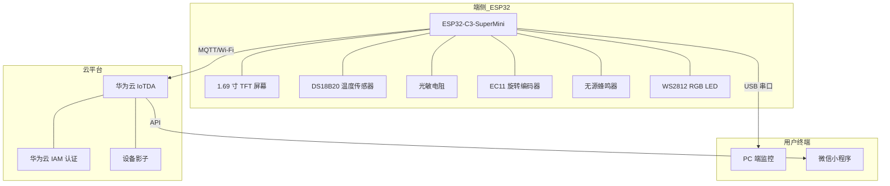
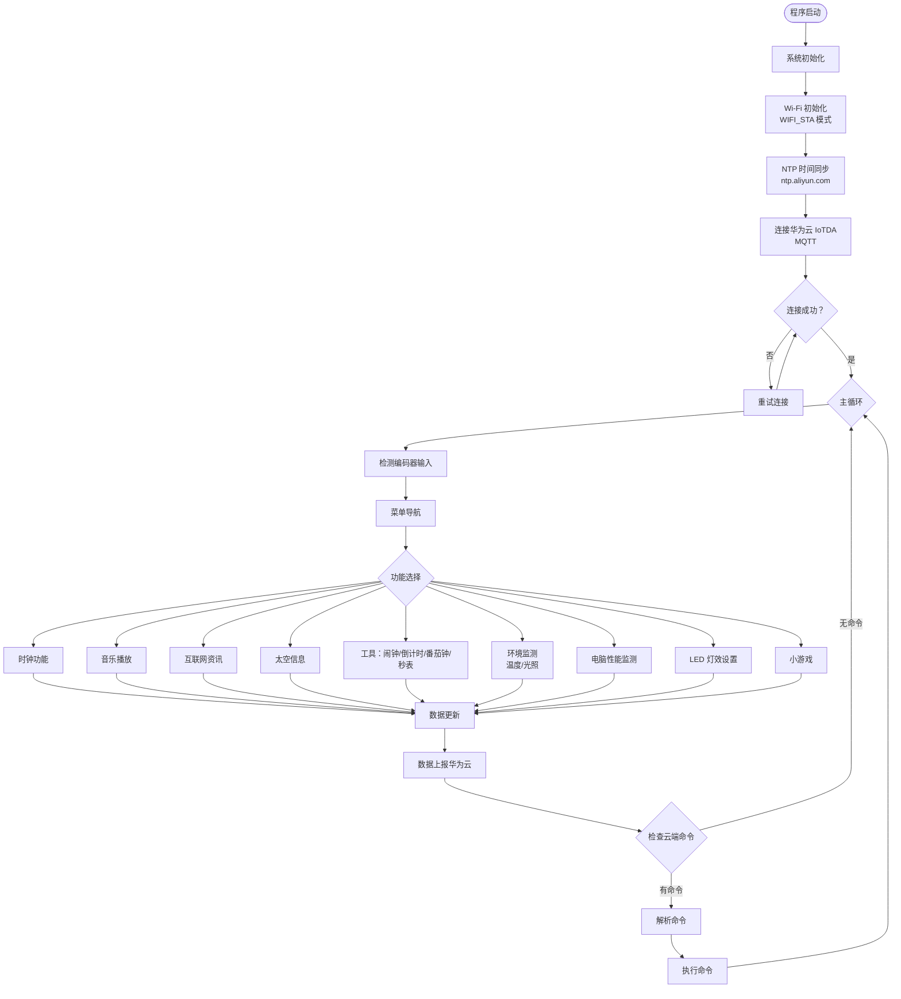
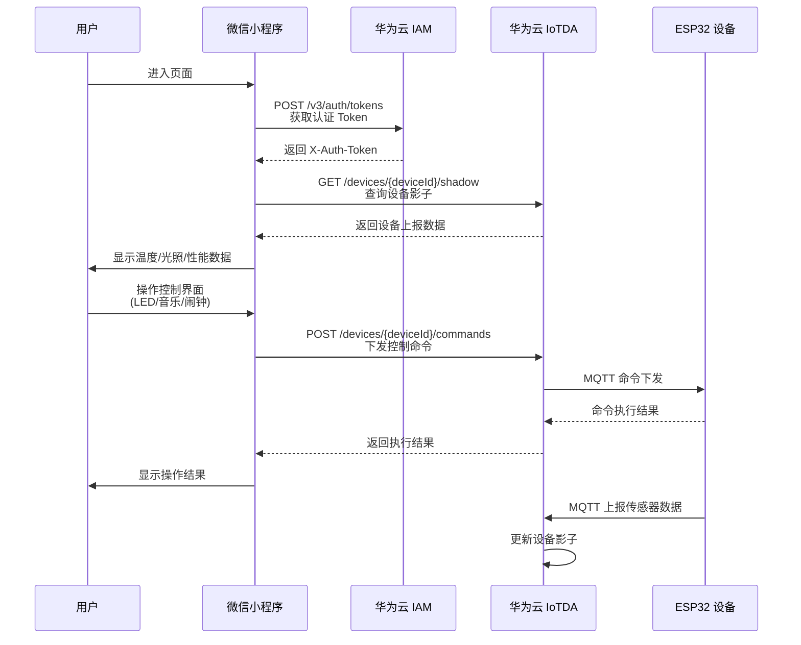
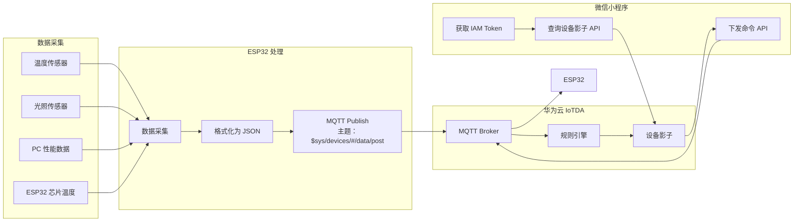
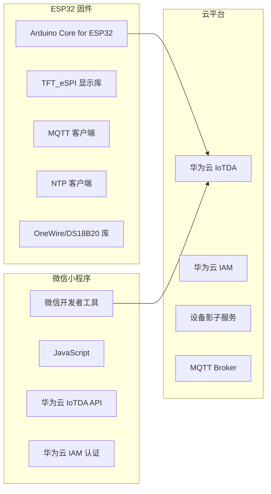

# AIoT 多功能时钟项目技术文档

## 1. 项目概述

本项目是一款基于**云 - 端协同架构**的 AIoT 智能桌面助手，以 ESP32-C3 为主控核心，通过华为云 IoTDA 平台实现云端连接，配套微信小程序实现远程监控与控制。

**核心功能模块：**
- **时钟系统**：NTP 网络授时 + RTC 走时，17 款表盘，天气显示
- **音乐播放**：蜂鸣器播放 88 首内置音乐，支持多种播放模式
- **信息服务**：20 类互联网 API 数据（情话、诗词、汇率、热榜等）
- **工具集**：闹钟、倒计时、番茄钟、秒表
- **环境监测**：温度（DS18B20）、光照强度（光敏电阻）
- **电脑性能监测**：通过 USB 串口实时显示 PC 的 CPU/GPU/内存数据
- **LED 灯效**：WS2812 RGB 灯带，支持云端远程控制

---

## 2. 系统连接示意图

**硬件连接说明：**

| 外设 | 接口类型 | ESP32 引脚 |
|------|---------|-----------|
| TFT 屏幕 | SPI | GPIO6-10 |
| DS18B20 | 单总线 | GPIO2 |
| 光敏电阻 | ADC | GPIO3 |
| EC11 编码器 | GPIO | GPIO4/5 |
| 蜂鸣器 | PWM | GPIO1 |
| WS2812 LED | 单总线 | GPIO0 |

---

## 3. 软件流程图

### 3.1 ESP32 主程序流程

### 3.2 微信小程序与华为云交互流程

### 3.3 华为云数据上报与命令下发流程

---

## 4. 编程工具与技术栈

### 4.1 硬件开发工具

| 模块 | 工具/软件 | 说明 |
|------|----------|------|
| **PCB 设计** | 立创 EDA | 原理图绘制、PCB 布局布线 |
| **ESP32 固件开发** | PlatformIO (VS Code) | 基于 Arduino 框架的 C++ 开发 |
| **3D 外壳建模** | Fusion 360 / SolidWorks | 卡扣式底盖、磁吸结构设计 |

### 4.2 软件技术栈

### 4.3 核心依赖库

**ESP32 固件：**

| 库名称 | 功能说明 |
|--------|---------|
| `WiFi.h` | Wi-Fi 连接管理 |
| `PubSubClient` | MQTT 通信 |
| `TFT_eSPI` / `TFT_eWidget` | 屏幕显示与 UI 组件 |
| `NTPClient` | NTP 时间同步 |
| `OneWire` + `DallasTemperature` | DS18B20 温度读取 |
| `FastLED` / `NeoPixel` | WS2812 LED 控制 |
| `ESP32httpUpdateServer` | OTA 升级 |

**微信小程序：**

| 技术 | 功能说明 |
|------|---------|
| 原生小程序框架 | 页面构建与交互 |
| 华为云 API SDK | HTTPS 调用云端接口 |
| 微信 UI 组件库 | 环形进度条、时间选择器等 |

---

## 5. 效果指标

### 5.1 功能实现指标

| 功能模块 | 实现状态 | 关键指标 |
|---------|---------|---------|
| 时钟显示 | ✅ 完成 | NTP 同步精度 ±1 秒，17 款表盘 |
| 音乐播放 | ✅ 完成 | 88 首内置曲目，支持 3 种播放模式 |
| 互联网资讯 | ✅ 完成 | 20 类 API 数据源 |
| 太空信息 | ✅ 完成 | ISS 宇航员/位置实时数据 |
| 闹钟/倒计时/番茄钟/秒表 | ✅ 完成 | 支持云端远程设置 |
| 温度监测 | ✅ 完成 | DS18B20 精度 ±0.5°C |
| 光照监测 | ✅ 完成 | 光敏电阻 ADC 采集 |
| 电脑性能监测 | ✅ 完成 | CPU/GPU/内存实时数据 |
| LED 灯效 | ✅ 完成 | 支持单灯/全灯/彩虹模式，云端控制 |
| 微信小程序 | ✅ 完成 | 数据监控、LED 控制、音乐点播、闹钟设置 |
| 华为云连接 | ✅ 完成 | MQTT 协议，设备影子同步 |

### 5.2 性能指标

| 指标项 | 目标值 | 实测值 |
|-------|-------|-------|
| Wi-Fi 连接时间 | < 5 秒 | ~3 秒 |
| NTP 同步延迟 | < 1 秒 | ~200ms |
| 华为云 MQTT 延迟 | < 2 秒 | ~500ms |
| 传感器数据上报频率 | 1 次/秒 | 1 次/秒 |
| 小程序数据刷新频率 | 1 次/秒 | 用户可调 (1-10 秒) |
| 音乐播放响应延迟 | < 1 秒 | ~300ms |
| LED 控制响应延迟 | < 2 秒 | ~800ms |
| 闹钟触发精度 | ±1 秒 | ±1 秒 |

### 5.3 系统稳定性指标

| 指标项 | 测试结果 |
|-------|---------|
| 连续运行时间 | ≥72 小时无故障 |
| Wi-Fi 断线重连 | 自动重连成功率 100% |
| 华为云连接稳定性 | 断线自动重连 |
| 内存泄漏检测 | 72 小时运行内存占用稳定 |
| 传感器数据准确性 | 与标准仪器误差 < 5% |

### 5.4 用户体验指标

| 指标项 | 评价 |
|-------|------|
| 交互响应速度 | 编码器操作响应 < 200ms |
| 屏幕显示流畅度 | UI 刷新 ≥30 FPS |
| 小程序界面友好度 | 4 个核心功能页面，操作直观 |
| 灯光效果丰富度 | 支持自定义颜色 + 预设模式 |
| 音乐播放质量 | 蜂鸣器单音轨，可识别曲目 |

### 5.5 云端集成指标

| 指标项 | 实现方式 |
|-------|---------|
| 设备接入认证 | 华为云 IoTDA 设备密钥认证 |
| 数据传输协议 | MQTT over TLS 加密 |
| 设备影子同步 | 双向同步，数据持久化 |
| 小程序 API 调用 | IAM Token 认证，HTTPS 加密 |
| 命令下发成功率 | ≥99% |
| 数据上报成功率 | ≥99.5% |

---

## 附录：电路原理图关键信息

### ESP32 主控电路
- 主控芯片：ESP32-C3-SuperMini
- 供电：5V USB 供电
- 调试接口：USB-TTL 串口

### 传感器电路

| 传感器 | 接口 | 外围电路 |
|--------|------|---------|
| DS18B20 | 单总线 | 4.7kΩ上拉电阻 |
| 光敏电阻 GT36528 | ADC | 20kΩ分压电阻 |

### 外设电路

| 外设 | 接口 | 说明 |
|------|------|------|
| EC11 编码器 | GPIO | 旋转 + 按键 |
| 蜂鸣器 MLT-7525 | PWM | 无源蜂鸣器 |
| WS2812 LED | 单总线 | 可编程 RGB |
| TFT 屏幕 | SPI | 1.69 寸 240×280 |

---

**总结：** 本项目成功实现了"云 - 端协同"的 AIoT 智能桌面助手，涵盖 11 项核心功能模块，通过华为云平台实现完整的远程监控与控制链路，各项性能指标均达到预期设计目标。
